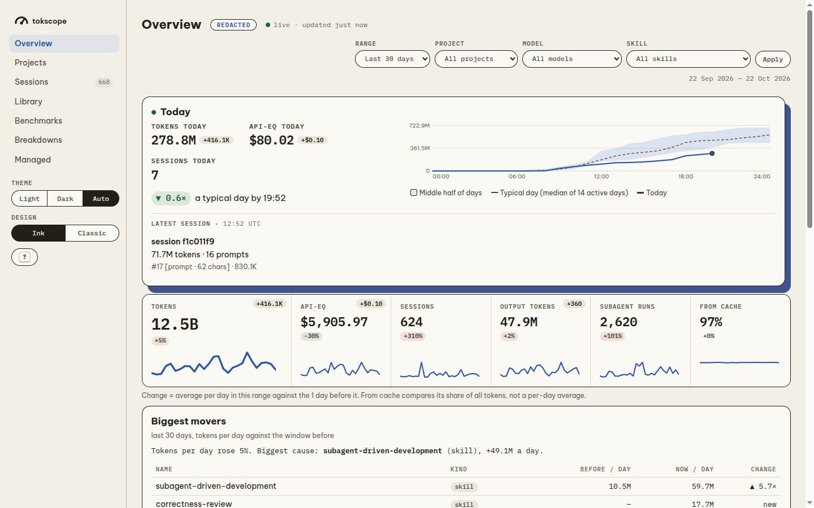
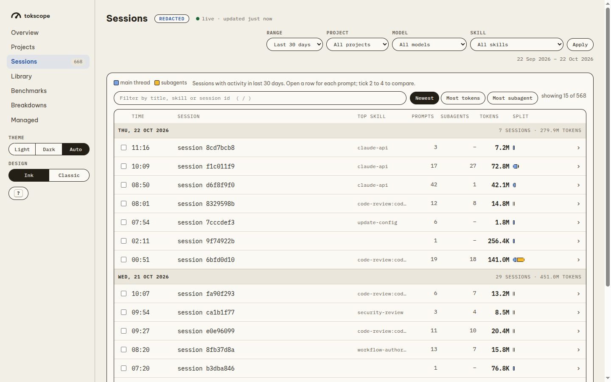
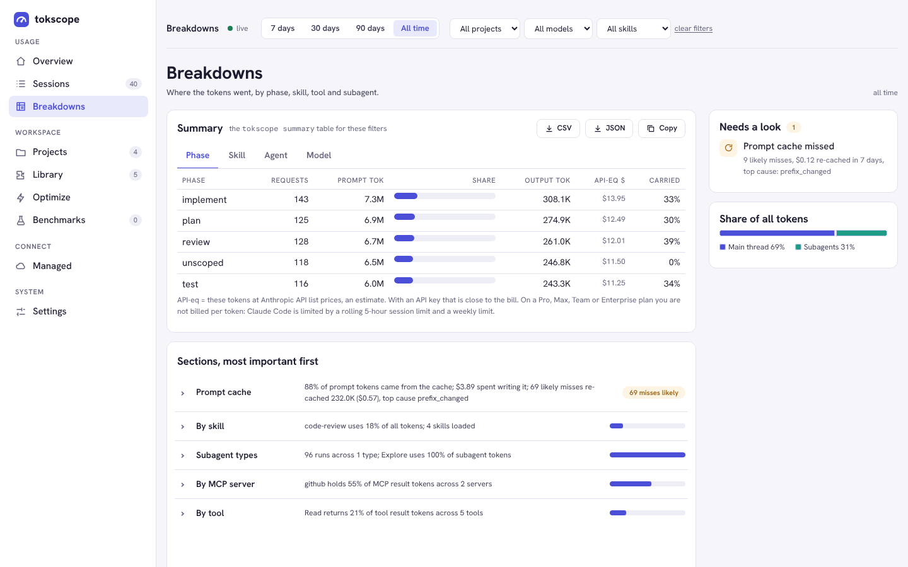
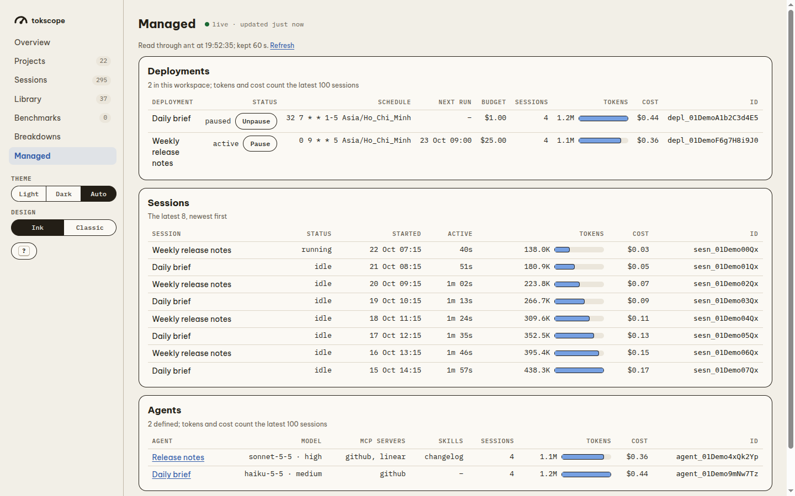
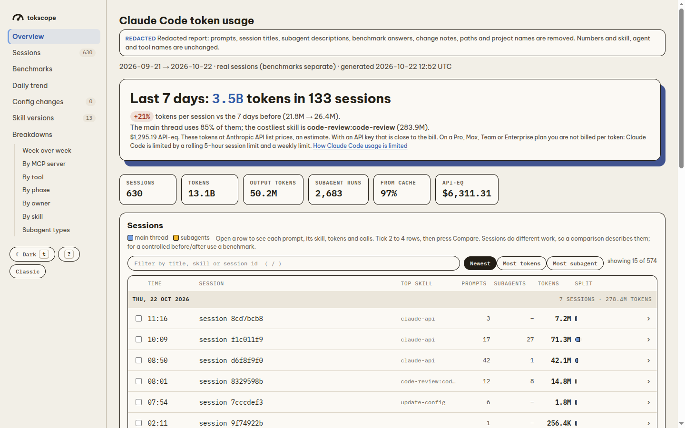

# tokscope

tokscope measures the tokens that Claude Code uses, per session, skill, subagent and phase. It reads the transcripts
in `~/.claude/projects`, keeps the numbers in a local SQLite database, and shows them in the terminal, in an HTML
report and in a live local dashboard. Nothing leaves your machine.

What each part does: [PRODUCT.md](PRODUCT.md).

## Screenshots

The usage screenshots come from `tokscope serve --privacy redacted` and `tokscope report --privacy redacted`, so they
show no prompts, titles, paths or project names. The Managed screenshot uses demo data.

**Overview**: today against a typical day, the totals with their change, and the biggest movers.



**Sessions**: each session by day, split between the main thread and subagents. Open a row for each prompt; tick 2 to 4 rows to compare.



**Breakdowns**: tokens by MCP server, tool, phase, owner, skill and subagent type, each with its finding. Its **Summary** section is the
`tokscope summary` table for the filter bar, with Download CSV, Download JSON and Copy (also `GET /api/summary?by=skill&format=csv`).



**Managed**: Claude Managed Agents deployments, sessions and agents, with Pause / Unpause (needs the `ant` CLI).



**Report** (`tokscope open`): one HTML file with the last 7 days, the totals, the sessions and the breakdowns.



## Requirements

- Linux, or macOS 12.3 or later.
- Python 3.10 or later. The CLI uses the standard library only.
- Claude Code, for the `/tokscope` mod, benchmarks and replays. git, for benchmarks, replays and skill versions.
- Optional: the `ant` CLI, signed in with `ant auth login`, for the dashboard's Managed page.

## Install from a clone

```sh
git clone https://github.com/minhtran3124/claude-code-tokscope.git
cd claude-code-tokscope
./setup.sh
tokscope --version
```

`setup.sh` links `bin/tokscope` to `~/.local/bin/tokscope` and adds the clone's `mod/` folder to
`CLAUDE_CODE_PLUGIN_DIRS` in `~/.claude/settings.json` (it keeps `settings.json.bak`). It is safe to run again. Start a
new Claude Code session to load the mod. `./setup.sh --uninstall` removes both. If you move the clone, run
`./setup.sh` again.

Without the script: `pipx install .` (or `uv tool install .`), then add the full path of `mod/` to
`CLAUDE_CODE_PLUGIN_DIRS` yourself.

## Run

```sh
tokscope ingest              # read your transcripts into the database (see below for other folders)
tokscope summary --by phase  # a table in the terminal (--by skill | agent | model)
tokscope summary --by skill --format csv > skills.csv   # or --format json: only the rows on stdout
tokscope skills --format csv > versions.csv   # each skill version: loads, tokens, errors, regression (or --format json)
tokscope open                # write the HTML report and open it
tokscope serve               # the live dashboard on http://127.0.0.1:8765
```

`tokscope serve` options: `--port N`, `--no-open`, `--interval S` (seconds between background ingests, default 10),
`--privacy redacted|numbers`, `--projects-dir PATH` (read that transcripts folder, not the default ones). In Claude Code, `/tokscope` shows the current session.

## Desktop app (Linux)

The desktop app is a window around the dashboard. A systemd user service keeps the server on `127.0.0.1:8770`, so
the window opens at once and the server keeps running when you close it.

**On your own machine, from the clone** (needs Node.js and npm):

```sh
desktop/install.sh               # window, menu entry and service for your user
desktop/install.sh --uninstall   # remove them
```

### Build the `.deb`

Build on Linux x86_64 with Node.js and npm (tested with Node 23, npm 10):

```sh
cd desktop
npm install
npm run dist
```

The file is `desktop/dist/tokscope_<version>_amd64.deb` (about 75 MB). The version comes from `desktop/package.json`.
It holds the Electron app, the CLI (`bin/` and `tokscope/`) and the service file, but not the Claude Code mod.

### Install the `.deb` on another machine

The other machine needs Ubuntu or Debian on x86_64 (amd64). `apt` installs Python 3.10+ and the other dependencies
when they are missing.

1. Copy the file to the machine, for example `scp desktop/dist/tokscope_0.2.0_amd64.deb user@host:~`.
2. Install it. Use the `./` path, so `apt` reads the local file and installs the dependencies:

   ```sh
   sudo apt install ./tokscope_0.2.0_amd64.deb
   ```

3. Turn on the server once, as each user who uses the app:

   ```sh
   systemctl --user enable --now tokscope
   ```

   It is not turned on for every user, because then another user of a shared machine could reach your dashboard on
   that port. Without the service, the window starts its own server on a free port and stops it on close.
4. Open **tokscope** from the app menu. To pin it, right-click its icon and choose **Add to Favorites**.
5. Optional, the CLI in a terminal: `ln -s /opt/tokscope/resources/bin/tokscope ~/.local/bin/tokscope`.
6. Optional, the Managed page: install the `ant` CLI on that machine and run `ant auth login`. The service finds
   `ant` in `~/.local/bin` or `~/bin` too.

Things to know:

- Transcripts come from `$CLAUDE_CONFIG_DIR/projects` (comma-separated list allowed), else every existing
  `~/.config/claude/projects` and `~/.claude/projects`. `tokscope ingest --projects-dir PATH` reads one folder instead;
  `ingest` prints the folders it read.
- The dashboard shows the Claude Code usage of **that** machine (its transcripts folders). Data is not copied
  between machines. It is kept in `~/.local/share/tokscope`.
- For `/tokscope` and the live pane in Claude Code on that machine, install from a clone as above; the `.deb` does
  not include the mod.
- To update, install the new `.deb` the same way, then run `systemctl --user restart tokscope`.
- To remove: `sudo apt remove tokscope`. Your data in `~/.local/share/tokscope` stays.

## Important information

- **Where data lives**: `$TOKSCOPE_HOME` if set; else the clone when you run `bin/tokscope`; else
  `~/.local/share/tokscope` (or `$XDG_DATA_HOME/tokscope`). On macOS a new install uses
  `~/Library/Application Support/tokscope`; an existing `~/.local/share/tokscope` is kept. It holds `data/tokscope.db`, the marks, the skill
  versions, the reports, the benchmarks and `privacy.key`. Git ignores all of it.
- **Reports hold private text.** The default report and the `full` dashboard show your prompts, titles and paths.
  Before you share a report, make it with `tokscope report --privacy redacted` (or `numbers`).
- **Dollars are estimates**: tokens at API list prices ("API-eq"), not what a plan charges. Fast mode (2x on Opus 5.5, 5
  and 4.8), US-only inference (1.1x on 4.6+ models) and web searches ($10 per 1,000) are priced from the transcript.
- **Price overrides**: `<data home>/pricing.json` replaces rates; totals follow on the next run, no re-ingest. Example:
  `{"web_search_per_1000": 10, "claude-opus-5-5": {"input": 4, "output": 20, "cache_read": 0.2, "fast": 2, "us": 1.1}}`
  (USD per million tokens; every key is optional for a known model, a new model needs input, output and cache_read).
- **Budgets**: `<data home>/budgets.json` sets limits for today (local day); no file means no budgets, a wrong file is an
  error that names the problem. Keys: `daily_usd`, `daily_tokens`, `block_pct`, `weekly_pct` (quota %, needs statusline
  snapshots that tokscope does not store yet, so it reports "no data"), `skills.<name>` and `agents.<name>` with
  `daily_usd`, `daily_tokens` and (skills) `per_load_tokens` (median of a load). Per-skill and per-agent spend is
  attributed as in `summary --by skill|agent`. Optional `regression` (`{"pct": 20, "min_loads": 5}`, off when absent,
  `{}` uses those defaults) compares each skill's newest tracked version with the previous one and counts as over when its
  median tokens per load is more than `pct` % higher with at least `min_loads` loads on both (`regression.<skill>` in
  `check`, so exit 11; a skill with one version or too few loads is not judged). It also shows in the statusline, the
  `SessionEnd` line (for skills that session loaded), Overview and the report's skill versions card. Example:
  `{"daily_usd": 50, "skills": {"xia2": {"per_load_tokens": 200000}}, "agents": {"reviewer": {"daily_usd": 10}}}`.
  `tokscope check --once [--json]` prints the state and exits 0 ok, 10 near (80% or more of any budget), 11 over, 30 no
  data (no file, nothing measurable, no requests) and 2 for a bad file. The live pane, the dashboard Overview and
  `tokscope statusline` (set it as Claude Code's `statusLine` command) warn at 80% and when over; the `SessionEnd`
  ingest prints one line when that session pushed a budget over a line. No network, no notifications of its own.
- **Local only**: the dashboard answers only on `127.0.0.1` and accepts changes only from pages it served.
- **Benchmarks and replays cost money or plan usage**: they start new `claude -p` sessions. Set `--runs` and `--budget`.
- **Transcripts expire** after Claude Code's `cleanupPeriodDays`. Set it high (for example 365) to keep history.

## Development

```sh
python3 -m unittest discover -s tests -q   # Python tests
claude plugin test mod                     # mod tests
claude plugin validate mod                 # mod validator
```

The version is in three places that must agree: `tokscope/__init__.py`, `mod/.claude-plugin/plugin.json` and
`CHANGELOG.md` (`tests/test_version.py` checks them). Change `desktop/package.json` too before you build a `.deb`.

Decisions: [DECISIONS.md](DECISIONS.md). Review rules: [REVIEW.md](REVIEW.md).

## License

Apache License 2.0. See `LICENSE` and `NOTICE`. Copyright 2026 Minh Tran.
